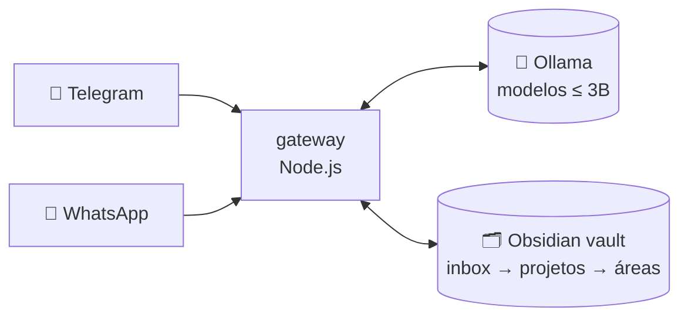

# 💬 Uma conversa com o Segundo Cérebro

**🧑 Você:** cérebro, resume meu dia.

**🧠 Cérebro:** 3 tarefas concluídas, 1 aula de Banco de Dados com anexo novo e 2 ideias no inbox. Quer que eu arquive?

**🧑 Você:** 📷 *[foto do quadro]* que matéria é essa?

**🧠 Cérebro:** Lógica de Predicados — salvei em `faculdade/LÓGICA MATEMÁTICA/` com o PDF da aula.

**🧑 Você:** 🎙️ *[áudio de 40s]* transforma em tarefa para amanhã 8h.

**🧠 Cérebro:** transcrevi, criei a tarefa e te chamo no Telegram às 8h. E relaxa: nada disso saiu desta máquina.

**🧑 Você:** e se cair a internet?

**🧠 Cérebro:** continuo funcionando. Ollama é local, o vault é pasta. Só o WhatsApp precisa de rede.

---

Isso não é print de suporte — é o projeto: IA pessoal **100% local e grátis**. Você fala no **Telegram ou WhatsApp**, o gateway consulta modelos abertos pequenos (**Ollama**), lê e escreve no seu vault **Obsidian**. R$ 0 por mês.


<a href="https://github.com/Wagner-Schemmer/segundo-cerebro"></a>

## Por dentro da ligação



| Canal | Faz | Onde |
|---|---|---|
| **Telegram** | Conversa, lembretes, resumos, transcrição de áudio | ✓ bot local (Telegraf) |
| **WhatsApp** | Foto, áudio e texto viram nota no vault | ✓ Evolution API |
| **Ollama** | Responde sem nuvem (ex.: `qwen2.5:1.5b`) | ✓ `localhost` |
| **Obsidian** | Guarda tudo em Markdown pesquisável | ✓ pasta `cerebro/` |

## Por que não um app pronto?

| Nuvem / assinatura | Aqui |
|---|---|
| Seus dados treinam modelo alheio | **Ficam no seu disco** |
| Mensalidade | **R$ 0** |
| Só funciona no app deles | **Funciona onde você já fala** |

## Entrar na conversa

```bash
ollama pull qwen2.5:1.5b
cd gateway && cp .env.example .env   # colar TELEGRAM_BOT_TOKEN
npm install && npm start
```

<details>
<summary><b>Detalhes: variáveis do .env e reserva Docker</b></summary>

- `TELEGRAM_BOT_TOKEN` (BotFather), `ANTHROPIC_API_KEY` / `GOOGLE_API_KEY` / `OPENROUTER_API_KEY` (opcionais, fase 2), `EVOLUTION_API_KEY` (WhatsApp), `DATABASE_URL` (hub Postgres).
- `docker-compose.yml` guardado para quando houver mais RAM ou um VPS.

</details>

## Onde mora cada memória

`cerebro/` é o vault: `00-inbox` · `01-projetos` · `02-areas` (ex.: faculdade) · `03-recursos` · `04-arquivo`. `gateway/` é o bot. `workflows/`, as automações futuras.

---
Feito por [Wagner Schemmer](https://wagner-port.vercel.app) · [Portfólio](https://wagner-port.vercel.app) · [LinkedIn](https://www.linkedin.com/in/wagner-schemmer-martins-46950627a)
