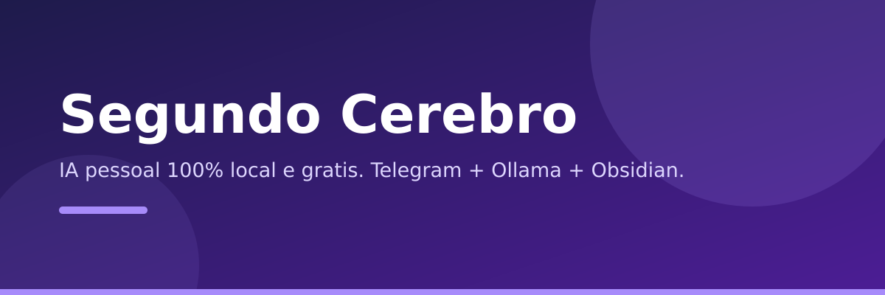

<div align="center">

[](https://github.com/Wagner-Schemmer/segundo-cerebro/stargazers)


  

  <h1>Segundo Cérebro</h1>

  <p>
    <b>IA pessoal 100% local e grátis.</b>
    <br />
    Telegram + WhatsApp → gateway Node.js → Ollama → base de conhecimento no Obsidian.
  </p>

  <p>
    <a href="#o-que-cada-canal-faz"><b>Canais</b></a> ·
    <a href="#como-rodar">Como rodar</a> ·
    <a href="#como-se-compara">Comparar</a> ·
    <a href="#estrutura">Estrutura</a> ·
    <a href="#stack">Stack</a>
  </p>
</div>

Sistema de IA pessoal que mora na sua máquina: você fala no Telegram ou WhatsApp, o gateway consulta seus modelos locais (Ollama ≤ 3B) e lê/escreve no seu vault Obsidian. Nada vai para a nuvem, nada custa por mês.

## O que cada canal faz

| Canal | O que faz | Onde roda |
|---|---|---|
| **Telegram** | Conversa com o cérebro, recebe lembretes e resumos | ✓ bot local (Telegraf) |
| **WhatsApp** | Manda áudio, foto e texto que viram nota no vault | ✓ via Evolution API |
| **Ollama** | Responde com modelos abertos pequenos (ex.: qwen2.5:1.5b) | ✓ `localhost` |
| **Obsidian** | Guarda tudo: inbox, projetos, áreas, recursos, arquivo | ✓ pasta `cerebro/` |

## Como se compara

| | Assistentes na nuvem / sync pago | Segundo Cérebro |
|---|---|---|
| Seus dados saem da máquina | Sim | **Não** |
| Mensalidade | Frequentemente | **R$ 0** |
| Fala no WhatsApp/Telegram | Raramente | **Sim** |
| Código aberto e seu | Não | **Sim** |

## Como rodar

```bash
# 1. Baixar um modelo (só uma vez)
ollama pull qwen2.5:1.5b

# 2. Configurar
cd gateway
cp .env.example .env   # editar: colar TELEGRAM_BOT_TOKEN

# 3. Instalar e subir
npm install
npm start
```

> [!NOTE]
> As chaves moram no `.env` (nunca commitado). O `docker-compose.yml` é reserva para quando houver mais RAM ou um VPS.

## Estrutura

```
cerebro/            ← VAULT DO OBSIDIAN (abrir esta pasta como vault)
  00-inbox/         ← tudo que chega do Telegram/WhatsApp
  01-projetos/      ← com prazo/objetivo
  02-areas/         ← responsabilidade contínua (ex.: faculdade)
  03-recursos/      ← referências úteis
  04-arquivo/       ← inativo
gateway/            ← código do bot (Telegram + WhatsApp + Ollama)
workflows/          ← automações futuras
docker-compose.yml  ← reserva p/ quando tiver mais RAM ou um VPS
```

## Stack

Node.js · Telegraf · Ollama · Obsidian (Markdown). Docker opcional.

## Quem faz

<a href="https://github.com/Wagner-Schemmer/segundo-cerebro/graphs/contributors"></a>

## Star history

<a href="https://www.star-history.com/#Wagner-Schemmer/segundo-cerebro&Date"></a>

---
Feito por [Wagner Schemmer](https://wagner-port.vercel.app) · [Portfólio](https://wagner-port.vercel.app) · [LinkedIn](https://www.linkedin.com/in/wagner-schemmer-martins-46950627a)
