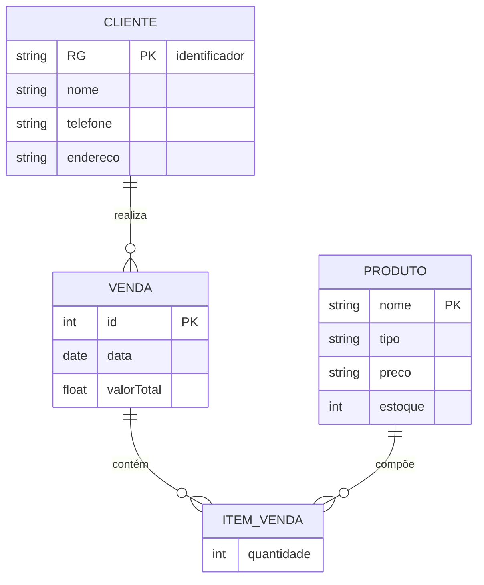
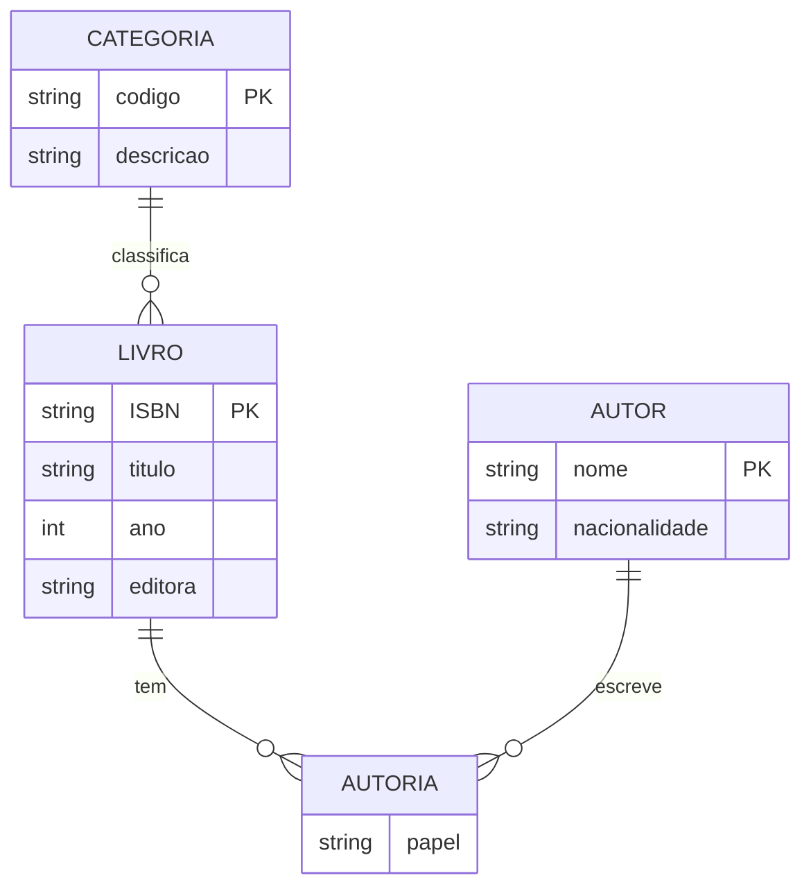
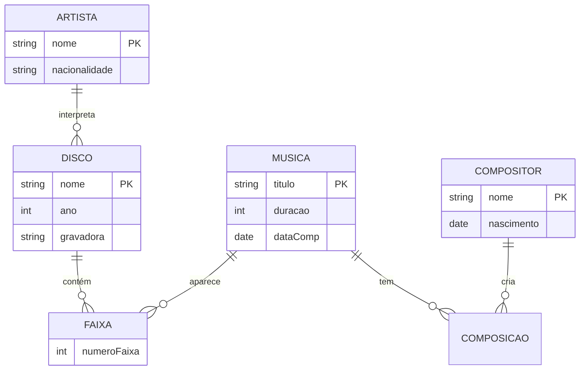
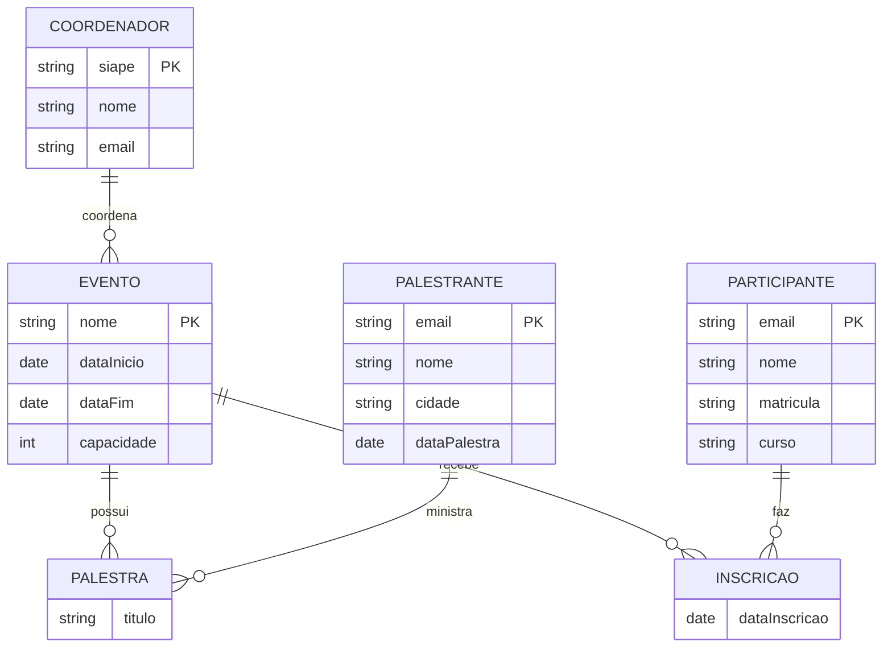
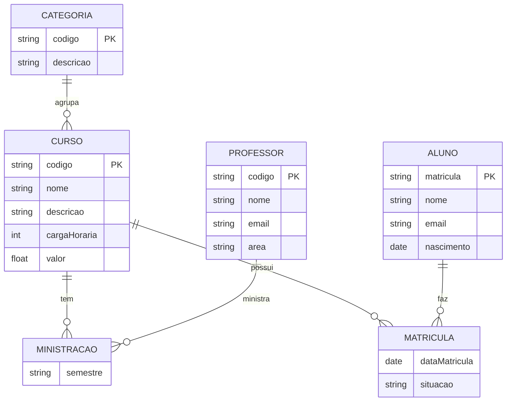
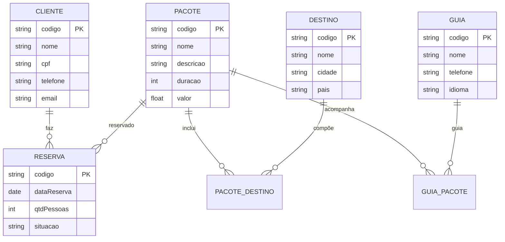

# Atividade 03 — Abordagem Relacional — BANCO DE DADOS I

> Prof. Me. Fiorin • IFFAR FW • Entrega 02/09/2026
> 6 estudos de caso — modelagem conceitual (DER) + cardinalidades

## 1) Floricultura

**REGRAS:** Cliente(1:N)Venda, Venda(N:M)Produto via Item_Venda com quantidade. RG é PK de Cliente.

## 2) Biblioteca

**REGRAS:** Livro(N:M)Autor, Livro(N:1)Categoria. Autoria é tabela associativa M:N.

## 3) Catálogo de CDs

**REGRAS:** Disco(N:M)Musica via Faixa (atributo numeroFaixa), Musica(N:M)Compositor (≥1), Disco(N:1)Artista.

## 4) Controle de eventos acadêmicos

**REGRAS:** Evento(1:N)Palestra, Palestrante(1:N)Palestra, Evento(N:M)Participante via Inscrição, Coordenador(1:N)Evento.

## 5) Sistema de cursos online

**REGRAS:** Curso(N:1)Categoria, Curso(N:M)Professor via Ministração, Curso(N:M)Aluno via Matrícula (com situacao).

## 6) Sistema agência de viagens

**REGRAS:** Pacote(N:M)Destino, Pacote(N:M)Guia, Cliente(1:N)Reserva, Reserva(N:1)Pacote.

---
### Como reproduzir no brModelo (5 min por caso)
1. Abra `brModelo.jar` → Arquivo → Novo → Modelo Conceitual
2. Crie entidades (retângulos) com atributos (elipses) — PK sublinhado
3. Ligue com relacionamentos (losangos) e anote cardinalidades (1:N, N:M) como acima
4. Salve como `Atividade03_Floricultura.brM` etc em `Banco de Dados I/anexos/`
> Dica: use o Mermaid acima colado no Obsidian pra visualizar antes de desenhar.

Arquivos salvos em `cerebro/02-areas/faculdade/BANCO DE DADOS I/anexos/` + sincronizados pro Notion Materiais.
